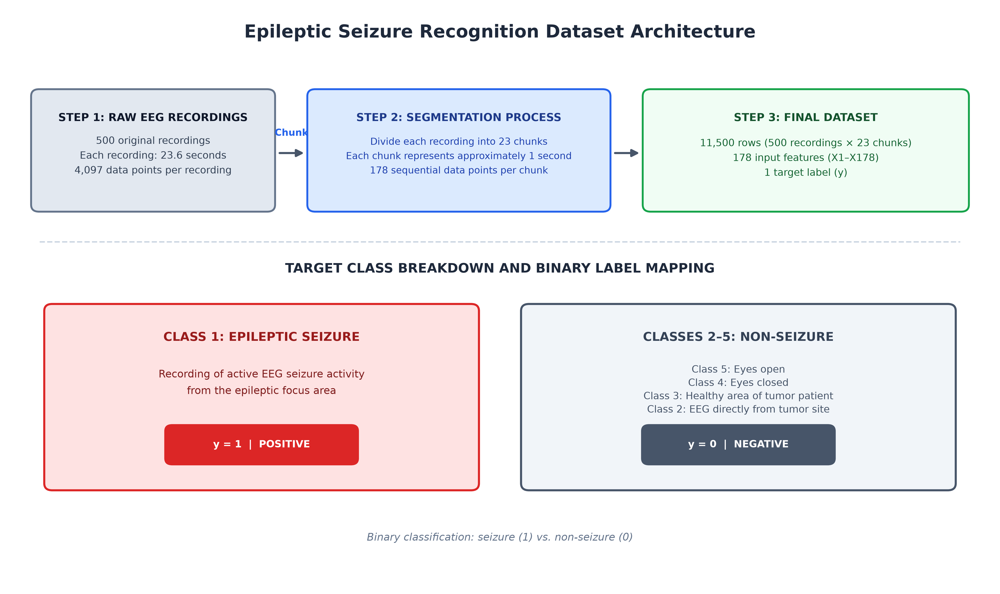
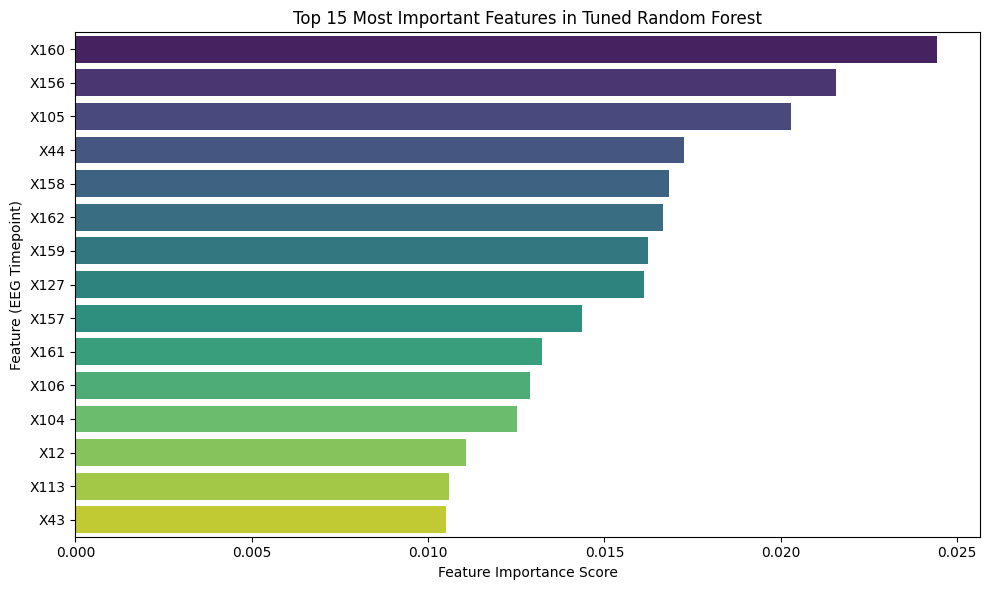
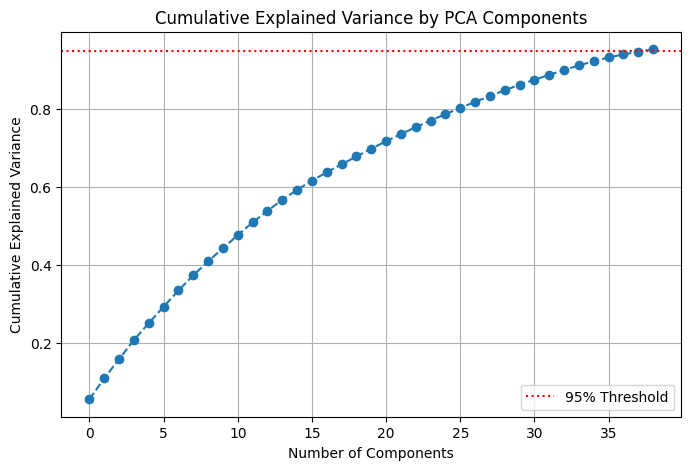
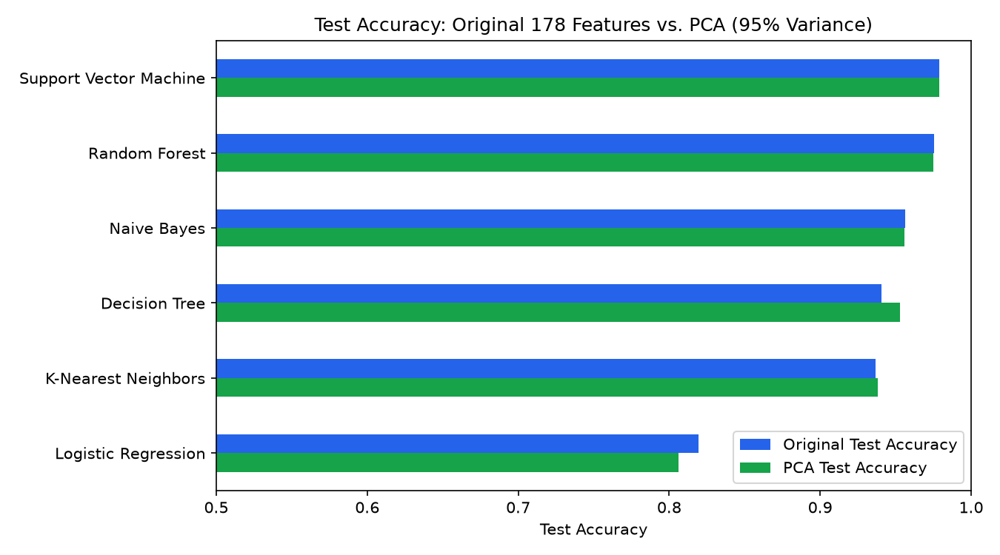

# Biomedical AI: Machine Learning Seizure Detection Model

Binary classification of epileptic seizures from single-channel EEG segments using the
**Epileptic Seizure Recognition** dataset. Six classical machine learning models are tuned with
5-fold cross-validated grid search, evaluated on a held-out test set, interpreted with feature
importances, and re-evaluated after PCA dimensionality reduction.

**Best result:** an RBF-kernel Support Vector Machine reaches **97.9% test accuracy**
(F1 = 0.946, ROC-AUC = 0.996) on 2,300 held-out EEG segments.



---

## Repository structure

```
.
├── Biomed_AI_Seizure_Project.ipynb        # Main analysis notebook (with saved outputs)
├── scripts/
│   ├── seizure_detection_pipeline.py      # Script version of the full analysis (Sections 1-9)
│   └── plot_dataset_architecture.py       # Draws the dataset architecture diagram
├── figures/                               # All figures used in the report
├── results/                               # Result tables (CSV) from the notebook run
├── data/                                  # Put the downloaded dataset here (not tracked)
├── requirements.txt
└── README.md
```

| File | What it does |
| --- | --- |
| `Biomed_AI_Seizure_Project.ipynb` | The full analysis with explanations and the outputs reported below. Originally run in Google Colab. |
| `scripts/seizure_detection_pipeline.py` | Runs the same pipeline from the command line and saves every table to `results/` and every plot to `figures/`. |
| `scripts/plot_dataset_architecture.py` | Recreates `figures/dataset_architecture.png`. |

## Dataset

- **Source:** [Epileptic Seizure Recognition (Kaggle)](https://www.kaggle.com/datasets/harunshimanto/epileptic-seizure-recognition),
  a restructured version of the Bonn University EEG database
  (Andrzejak et al., 2001, *Physical Review E* 64, 061907).
- **Structure:** 500 recordings of 23.6 s (4,097 samples each) were split into 23 one-second chunks
  of 178 samples, giving **11,500 rows** with features `X1`–`X178` (EEG amplitude, sampled at 173.61 Hz).
- **Labels (`y`):** 1 = seizure activity, 2 = tumor region, 3 = healthy region of tumor patient,
  4 = eyes closed, 5 = eyes open.
- **Binary task:** class 1 → `1` (seizure, 20% of rows); classes 2–5 → `0` (non-seizure).

The dataset is not included in this repository. See [`data/README.md`](data/README.md) for download instructions.

## Methods

1. **Load** `archive.zip` directly with pandas.
2. **Preprocess:** binarize the target, drop the `Unnamed` ID column, make a stratified 80/20
   train/test split (`random_state=42`), and standardize features with `StandardScaler` fit on the training set only.
3. **Tune six classifiers** with `GridSearchCV` (5-fold CV, accuracy scoring): Logistic Regression,
   K-Nearest Neighbors, SVM (RBF), Decision Tree, Random Forest, Gaussian Naive Bayes.
4. **Evaluate** each best estimator on the test set: accuracy, precision, recall, F1, ROC-AUC.
5. **Explain:** rank the top 15 features of the best interpretable model (Random Forest) and map the
   top timepoints to their position in the 1-second window (`index / 173.61 Hz`).
6. **PCA:** keep the components explaining 95% of variance (178 → 39 features) and repeat steps 3–4.
7. **Compare** test performance on original vs. PCA-reduced features.

## Results

### Tuned models on the original 178 features

| Model | CV Accuracy | Test Accuracy | Precision | Recall | F1 | ROC-AUC |
| --- | --- | --- | --- | --- | --- | --- |
| Support Vector Machine | 0.977 | **0.979** | 0.956 | 0.937 | **0.946** | 0.996 |
| Random Forest | 0.973 | 0.976 | 0.951 | 0.926 | 0.938 | **0.997** |
| Naive Bayes | 0.957 | 0.956 | 0.888 | 0.893 | 0.891 | 0.984 |
| Decision Tree | 0.939 | 0.941 | 0.915 | 0.776 | 0.840 | 0.920 |
| K-Nearest Neighbors | 0.929 | 0.937 | 0.994 | 0.687 | 0.812 | 0.911 |
| Logistic Regression | 0.823 | 0.820 | 0.925 | 0.107 | 0.191 | 0.500 |

Full table including best hyperparameters: [`results/tuned_results_original.csv`](results/tuned_results_original.csv).

### Feature importance (Random Forest)



| Feature | Importance | Time within 1-s window |
| --- | --- | --- |
| X160 | 0.0244 | 0.922 s |
| X156 | 0.0216 | 0.899 s |
| X105 | 0.0203 | 0.605 s |
| X44 | 0.0172 | 0.253 s |
| X158 | 0.0168 | 0.910 s |

### PCA and original vs. PCA comparison

PCA kept **39 of 178** components to explain 95% of the variance.





| Model | Original Test Acc. | PCA Test Acc. | Original F1 | PCA F1 |
| --- | --- | --- | --- | --- |
| Support Vector Machine | 0.9787 | 0.9791 | 0.9462 | 0.9475 |
| Random Forest | 0.9757 | 0.9748 | 0.9383 | 0.9376 |
| Naive Bayes | 0.9561 | 0.9557 | 0.8906 | 0.8926 |
| Decision Tree | 0.9409 | 0.9530 | 0.8400 | 0.8803 |
| K-Nearest Neighbors | 0.9365 | 0.9383 | 0.8123 | 0.8184 |
| Logistic Regression | 0.8196 | 0.8061 | 0.1910 | 0.0591 |

PCA cut the feature count by 78% with essentially no loss in accuracy for the top models,
improved the Decision Tree (+1.2% accuracy, +0.04 F1), and roughly halved SVM grid-search time.
Linear models performed poorly in both settings, which is expected: seizure activity is not linearly
separable from raw, phase-shifted amplitude values.

Full comparison: [`results/comparison_original_vs_pca.csv`](results/comparison_original_vs_pca.csv).

## How to reproduce

### 1. Set up the environment

Requires Python 3.10 or newer.

```bash
git clone https://github.com/bradystemac/Biomedical-AI-Machine-Learning-Seizure-Detection-Model.git
cd Biomedical-AI-Machine-Learning-Seizure-Detection-Model
python -m venv .venv
# Windows: .venv\Scripts\activate    macOS/Linux: source .venv/bin/activate
pip install -r requirements.txt
```

### 2. Get the data

Download `archive.zip` from [Kaggle](https://www.kaggle.com/datasets/harunshimanto/epileptic-seizure-recognition)
and save it as `data/archive.zip`.

### 3a. Run the scripts

```bash
python scripts/plot_dataset_architecture.py
python scripts/seizure_detection_pipeline.py --data data/archive.zip
```

The pipeline prints every result table and writes:

- `results/tuned_results_original.csv`, `results/tuned_results_pca.csv`, `results/comparison_original_vs_pca.csv`
- `results/feature_importance_top15.csv`, `results/temporal_mapping_top5.csv`
- `figures/feature_importance_top15.png`, `figures/pca_cumulative_variance.png`, `figures/original_vs_pca_accuracy.png`

A full run takes about 10 minutes on a typical laptop (most of it is the SVM and Random Forest grid searches).

### 3b. Or run the notebook

- **Google Colab (as originally run):** upload `archive.zip` to the Colab file browser root and run all cells.
  The notebook reads it from `/archive.zip`.
- **Locally with Jupyter:** run `jupyter notebook Biomed_AI_Seizure_Project.ipynb` and change
  `zip_path = '/archive.zip'` in Section 1 to `zip_path = 'data/archive.zip'`.

### Reproducibility notes

- Every source of randomness (train/test split, models, PCA) is seeded with `random_state=42`.
- Grid-search timings depend on hardware. Small differences in scores can appear across
  scikit-learn versions.
